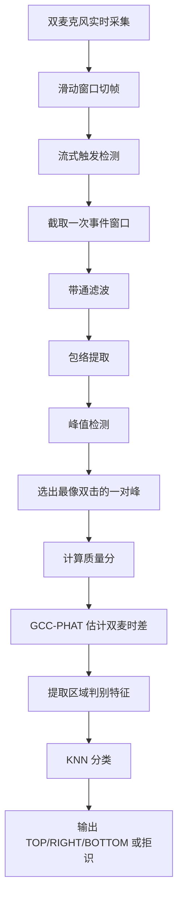
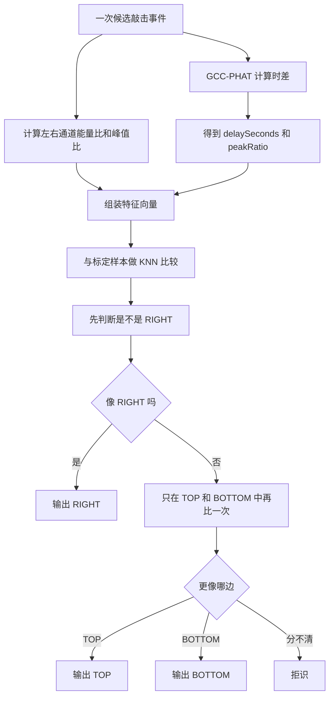

# 当前项目技术报告

## 1. 项目本质

这不是视觉识别项目，没有用到相机、OpenCV、目标检测、图像分割这类技术。

当前项目是一个 **Android 双麦克风敲击声识别系统**。系统通过手机左右两个麦克风采集声音，分析一次敲击事件在两个通道上的差异，再判断敲击更像来自哪个区域。

当前定义的区域只有 3 个：

- `TOP`
- `RIGHT`
- `BOTTOM`

这里的“区域”不是屏幕坐标，也不是图像里的框，而是 **设备表面上的三个声学区域**。

---

## 2. 主要技术

| 类别 | 当前使用的技术 | 说明 |
|---|---|---|
| 平台 | Android | 手机端实时运行 |
| 语言 | Kotlin | 主要开发语言 |
| UI | Jetpack Compose、Material 3 | 页面和状态展示 |
| 音频采集 | `AudioRecord`、PCM 16bit、双声道 | 从左右麦克风读取原始音频 |
| 信号处理 | 自定义 DSP | 包括滤波、包络、峰值检测、能量计算 |
| 时差估计 | GCC-PHAT | 估计左右通道谁先到、差多少 |
| 区域分类 | KNN | 用标定样本做最近邻分类 |
| 标定数据存储 | JSON | 保存到 `tap_calibration.json` |
| 架构 | ViewModel + Flow | 管理状态和检测结果 |

补充说明：

- **DSP**：数字信号处理。这里就是对声音波形做数学处理。
- **GCC-PHAT**：一种常见的双麦时差估计算法，用来算“左边先听到还是右边先听到”。
- **KNN**：K 近邻。把当前样本和历史标定样本比较，看看更像哪一类。
- **标定**：先让用户在每个区域敲几次，收集该区域的参考样本。

---

## 3. 整体处理链路



一句话概括：

**先判断这次声音是不是一次有效敲击，再根据左右麦克风的时差和强弱差别，判断更像哪个区域。**

---

## 4. 区域判别办法

这是项目里最关键的部分。

### 4.1 当前不是直接算“坐标”

系统不会输出一个二维坐标，比如 `(x, y)`。

它现在做的是 **三区域分类**：

- 更像上方区域，就判成 `TOP`
- 更像右侧区域，就判成 `RIGHT`
- 更像下方区域，就判成 `BOTTOM`

所以本质上是：

**声学特征提取 + 标定样本比较 + 分类决策**

不是：

- 图像定位
- 像素分割
- 目标框检测

---

### 4.2 区域判别依赖哪些信息

系统主要看下面几类信息：

1. **双麦时差 `delaySeconds`**
   左右两个麦克风接收到同一次敲击，通常不会完全同时到达。  
   如果左边先到、右边后到，或者差值大小不同，就说明敲击位置的方向不同。

2. **双通道能量比 `channelEnergyRatio`**
   同一事件里，左通道和右通道总能量谁更强。

3. **双通道峰值比 `channelPeakRatio`**
   同一事件里，左右通道峰值谁更高。

4. **第一下/第二下峰值比**
   当前项目把一次有效敲击看成一个较稳定的双峰事件，会分别比较第一下和第二下在左右通道上的比例。

5. **时差置信度 `lagConfidence`**
   这个值表示当前时差估计是否“尖锐、可靠”。如果 GCC 主峰不明显，说明这次时差估计不稳定。

这些特征一起组成一个特征向量，然后拿去做区域分类。

---

### 4.3 从声音到“区域”的具体步骤



---

### 4.4 代码里的真实实现方式

核心文件：

- `app/src/main/java/com/example/testppppp/audio/classification/TapDirectionClassifier.kt`

核心入口：

- `classify(...)`

当前分类器做的事可以拆成 4 步。

#### 第 1 步：把当前事件转成特征向量

分类器会把输入整理成一个 6 维特征：

- `delaySeconds`
- `logEnergyRatio`
- `logCombinedPeakRatio`
- `logFirstPeakRatio`
- `logSecondPeakRatio`
- `lagConfidence`

这里的 `log` 是对数变换，作用是把比值拉到更稳定的范围，避免某些比值过大时影响过重。

#### 第 2 步：和标定样本做 KNN 比较

分类器会读取标定得到的 `rawSamples`，把每个区域的样本都转成同样的特征向量，然后计算距离。

这里的距离不是普通直线距离，而是 **带权重、按尺度归一化后的欧氏距离**。

意思是：

- 每个特征的重要性不同，要乘不同权重
- 每个特征的数值范围不同，要先做尺度归一化

这样能避免某个量纲特别大的特征把结果“压过去”。

#### 第 3 步：先做 `RIGHT` 门控

当前逻辑不是一次性平等地在 `TOP / RIGHT / BOTTOM` 三类里直接选。

它先单独做一个二分类：

- `RIGHT`
- `NOT_RIGHT`

如果结果足够像 `RIGHT`，就直接输出 `RIGHT`。

如果结果足够不像 `RIGHT`，再只在 `TOP` 和 `BOTTOM` 之间继续比较。

如果两边都不够明确，就直接拒识。

这一步可以理解成：

**先把右侧区域单独拎出来判断，再区分上下。**

#### 第 4 步：做拒识

就算 KNN 给出了某个区域，系统也不一定马上认。

还会继续检查：

- 最优类别和第二名差距是否太小
- GCC 主峰是否明显
- 综合置信度是否够高
- 质量分是否够高

如果这些条件不过，就返回“拒识”，而不是硬判一个区域。

这一步非常重要，因为它决定系统是“宁可少报，也不要乱报”。

---

### 4.5 先判断“是不是有效敲击”

区域分类之前，系统先做事件筛选。

核心文件：

- `app/src/main/java/com/example/testppppp/audio/detection/StreamingTapDetector.kt`
- `app/src/main/java/com/example/testppppp/audio/detection/TapDetectionPipeline.kt`

主要过程：

1. 对左右通道做带通滤波
2. 合并双通道
3. 计算包络
4. 找局部峰值
5. 从相邻峰里找出最像一次有效双击的一对峰
6. 计算质量分

这里会检查很多规则，例如：

- 响度够不够
- 信噪比够不够
- 是否像近场敲击
- 峰够不够尖锐
- 双击间隔是否合理
- 第二下是否过轻或过重
- 左右通道是否过于不一致

如果这些不过，就不会进入后面的区域分类，或者会在分类阶段被拒识。

也就是说，系统不是“听到声就分区域”，而是：

**先确认这像一次有效敲击，再判断它属于哪个区域。**

---

## 5. 为什么双麦时差能帮助判别区域

可以把两个麦克风理解成两个“耳朵”。

如果敲击更偏向设备某一侧，那么声音到两个麦克风的距离通常不同，因此：

- 到达时间不同
- 强度也可能不同

项目里最重要的区域线索，实际上就是这两类差异：

1. **到达先后差**
2. **左右强弱差**

当前系统并不是用一个固定公式直接把时差换成区域，而是：

- 先通过标定收集每个区域的参考样本
- 再把当前敲击和这些样本比较
- 看它更像哪个区域

所以可以把当前方法理解成：

**“基于双麦几何差异的样本匹配分类”**

---

## 5.1 数学估算与关键数值

这一部分专门记录一些对理解系统很重要的数量级估算。

### 当前关键参数

| 参数 | 当前值 | 含义 |
|---|---:|---|
| 采样率 | `16,000 Hz` | 每秒采 16000 个点 |
| 采样周期 | `1 / 16000 = 62.5 us` | 相邻两个采样点的时间间隔 |
| 双麦距离 | `0.12 m` | 配置中的麦克风间距 |
| 声速 | `343 m/s` | 常温空气中的近似声速 |
| 窗长 | `100 ms` | 实时处理的基础帧长 |
| 帧移 | `30 ms` | 两帧之间的滑动步长 |
| 事件前保留 | `40 ms` | 触发点之前保留的声音 |
| 事件后保留 | `360 ms` | 触发点之后保留的声音 |
| 事件总窗长 | `400 ms` | 一次事件分析的完整时间窗 |
| 峰间隔允许范围 | `35 ms ~ 360 ms` | 当前双峰候选范围 |
| 标定样本数 | 每区 `6` 个 | `TOP/RIGHT/BOTTOM` 各自样本数 |
| GCC 搜索窗 | `-5 ~ +5` 采样点 | 由 `maxLagSamples` 决定 |

### 最大理论时差

双麦最大理论时差近似为：

`TDoA_max = d / c`

代入当前参数：

- `d = 0.12 m`
- `c = 343 m/s`

得到：

`TDoA_max = 0.12 / 343 ≈ 0.0003499 s ≈ 350 us`

这表示：
在非常理想、而且声源位于双麦连线最偏侧方向时，左右麦克风最多也就差 **约 350 微秒**。

### 采样分辨率对应的时差量级

当前采样率是 `16 kHz`，所以一个采样点对应：

`T_sample = 1 / 16000 = 62.5 us`

因此最大理论时差相当于：

`350 / 62.5 ≈ 5.6`

也就是：

**整个最大时差范围，只有大约 5 到 6 个采样点。**

这正是当前区域判别难度较高的一个核心原因。

### 代码里的实际搜索范围

代码里不是保留 `5.6` 个采样点，而是直接取整：

- `maxLagSamples = ((0.12 / 343) * 16000).toInt() = 5`

也就是说，实际 GCC 搜索范围是：

- `-5, -4, -3, -2, -1, 0, 1, 2, 3, 4, 5`

共 11 个整数候选点。

换算成时间：

- `5 / 16000 = 312.5 us`

所以当前代码里，**整数采样级别的主搜索范围其实是约 `+-312.5 us`**。
后面虽然还有抛物线插值去做亚采样细化，但大框架仍然是建立在这 11 个主搜索点上的。

### 这个量级为什么敏感

如果时差估计误差达到 1 个采样点，那么误差就是：

- `62.5 us`

而最大理论时差才约：

- `350 us`

所以：

`62.5 / 350 ≈ 17.9%`

也就是说，**只要错 1 个采样点，误差就已经接近最大理论时差的 18%**。
如果环境反射、波形拖尾、双峰形状变化再叠加进去，三区域边界就很容易互相靠近。

---

## 5.2 TDoA 数学关系和示意

最基本的时差公式是：

`TDoA = (rL - rR) / c`

其中：

- `rL`：声源到左麦克风的距离
- `rR`：声源到右麦克风的距离
- `c`：声速

如果只看双麦连线方向上的左右偏移，那么 TDoA 可以粗略理解成一个从负到正变化的量：

```text
TDoA
 ^
 |          /
 |        /
 |      /
 |    /
 |  /
 |/
 +------------------------> 声源相对位置
 |\ 
 |  \
 |    \
 |      \
 |        \
 |

左侧更近 -> TDoA 为负
中间附近 -> TDoA 接近 0
右侧更近 -> TDoA 为正
```

如果从远场角度近似，常见关系可以写成：

`TDoA(theta) ≈ (d / c) * sin(theta)`

其中：

- `d`：双麦距离
- `theta`：声源相对正前方的角度

它的形状大致是一个正弦曲线：

```text
TDoA
 ^
 |                 .-''''-.
 |             .-''        ''-.
 |          .-'                '-.
 |---------'----------------------'--------> theta
 |      .-'                        '-.
 |   .-'                              '-.
 |.-'                                    '-.
 |

左侧角度: 负时差
正前方: 接近 0
右侧角度: 正时差
最大幅值: d / c
```

对我们当前参数：

`d / c ≈ 350 us`

所以这条曲线的上下摆幅本身就不大。

---

## 5.3 结合当前项目，为什么这会导致三区域难分

当前三区域不是在做连续坐标定位，而是在做 `TOP / RIGHT / BOTTOM` 分类。
但即使是分类，也仍然依赖 TDoA 和双通道强弱差来把三个区域拉开。

困难点在于：

1. `TDoA` 的理论动态范围本来就只有几百微秒
2. 当前采样周期是 `62.5 us`
3. 一次敲击不是理想脉冲，而是带有反射、拖尾和双峰结构
4. GCC 主峰有时不够尖锐，说明最优时差并不稳定
5. `TOP` 和 `BOTTOM` 在当前特征空间里可能本来就更接近

所以“手机两个麦克风距离太小，很多时候很难分辨谁先谁后”这个判断是对的，而且是一个很重要的物理层原因。

不过更准确地说，当前问题不是只有“谁先谁后”这一项，而是：

**双麦距离偏小，导致时差线索先天偏弱；再叠加通道能量比、峰值比也会受敲击方式和波形形状影响，于是三区域特征出现重叠。**

---

## 5.4 固定使用环境下，哪些问题要重点担心，哪些可以弱化

这个项目面向视障人群。对已经完成标定的用户来说，后续使用环境基本固定：

- 同一张桌子
- 大致相同的摆放位置
- 同一个手机壳
- 同一台手机

这会带来一个重要结论：

### 不需要过度担心的点

- 不同桌面材质之间的大范围迁移
- 不同手机壳之间的大范围迁移
- 不同设备之间的泛化
- 完全不同摆放方式下还能保持同样效果

也就是说，**我们当前不必优先解决“跨场景泛化”问题**。

### 仍然要重点担心的点

- 用户每次敲击的精确位置并不完全一样
- 敲击力度会波动
- 手指角度和接触方式会变化
- 手机摆放会有小幅偏移
- 环境里仍可能有短时噪声
- 同一区域内部样本的波形仍然会有离散度

因此，在固定环境前提下，问题重点应从“泛化能力”转成：

**同一用户、同一桌面、同一设备条件下，如何把三区域之间的特征间隔拉大，并把同一区域内部波动压小。**

---

## 6. 标定在这里的作用

标定文件：

- `app/src/main/java/com/example/testppppp/audio/calibration/CalibrationSession.kt`
- `app/src/main/java/com/example/testppppp/audio/calibration/CalibrationRepository.kt`

标定做的事很直接：

1. 按 `TOP -> RIGHT -> BOTTOM` 的顺序收集样本
2. 每个区域默认收集 6 个样本
3. 只收录质量分足够高的样本
4. 保存到本地 JSON
5. 分类时直接读取这些样本

这说明当前系统属于 **个体化、设备相关、场景相关的分类方案**。

对于本项目的目标用户，这种方案反而是合理的。因为标定完成后，后续使用环境通常不会频繁变化，系统可以更多利用“固定场景”这个条件，而不必把主要精力放在跨设备、跨桌面泛化上。

---

## 7. 关键术语简明解释

- **双通道**：左右两个音频通道，对应两个麦克风。
- **带通滤波**：只保留目标频段，压掉过低和过高的杂音。
- **包络**：把快速振荡的波形变成更平滑的“外轮廓”，便于找峰。
- **峰值检测**：找声音里最突出的点。
- **SNR（信噪比）**：有用信号相对背景噪声有多强。
- **近场能量比**：敲击点附近的能量是否明显高于背景。
- **瞬态**：声音是否足够短促、尖锐，敲击声通常瞬态更强。
- **GCC-PHAT**：用频域相关的方法估计双麦延迟。
- **主峰/次峰比**：GCC 结果里最高峰和第二高峰的比值，越大通常越可信。
- **特征向量**：把一次事件整理成若干数字，供分类器使用。
- **KNN**：看“离哪些已知样本最近”，再决定类别。
- **拒识**：系统认为当前结果不可靠，因此不给出区域结论。

---

## 8. 当前方案可以怎样概括

当前项目的区域判别方案可以概括成一句话：

**基于双麦克风时差和通道强弱差的三区域声学分类，前面带有规则过滤，后面带有 KNN 分类和拒识机制。**

如果再简化一点：

**先筛掉不像敲击的声音，再用“时差 + 左右强弱”去和标定样本比对，决定是上、右还是下。**

---

## 9. 当前问题、主要原因和后续方案

### 9.1 当前最主要的问题

当前最主要的问题不是“完全不能分区”，而是：

- 某些样本三区域之间分界不够开
- `TOP` 和 `BOTTOM` 更可能互相接近
- 某些时刻时差估计不稳定
- 有时会出现应当命中但被拒识，或者本该拒识但边界过近

一句话概括：

**当前系统能工作，但三区域特征可分性还不够强。**

### 9.2 可能的主要原因

按重要性排序，当前比较可能的主要原因有：

1. **双麦距离较小，TDoA 动态范围只有几百微秒**
2. **采样率只有 `16 kHz`，时差分辨率偏粗**
3. **当前特征主要还是时差和左右强弱比，信息维度还不够丰富**
4. **每区只有 6 个标定样本，KNN 对偶然样本较敏感**
5. **`TOP` 和 `BOTTOM` 之间在当前特征空间里本来可能就更接近**
6. **一次敲击的双峰结构会受力度、触点和接触方式影响**
7. **GCC 主峰不够尖锐时，时差估计会摇摆**

这里面，第 1 条就是当前最关键的物理层限制之一。

### 9.3 哪些原因在本项目里不是最高优先级

因为使用环境基本固定，所以这些问题不是当前最优先的：

- 跨手机型号泛化
- 跨桌面材质泛化
- 跨手机壳泛化
- 跨房间、跨场景泛化

这些不是完全不重要，而是 **优先级低于“固定环境下把三区域分得更稳”**。

### 9.4 后续可用于提高准确率的技术

下面这些是技术上可继续增强准确率的方向。这里优先写更适合当前固定环境前提的方案。

### 9.4.1 增强特征

当前主要特征还是时差和通道比值，后续可以加入：

- 更细的频带能量特征
- 峰前/峰后衰减速度
- 双峰间更详细的形状特征
- 每个通道的谱质心、谱滚降等频谱特征
- 更稳定的多窗口时差特征

作用：

- 让不同区域之间的差异更容易被分开
- 降低单一时差特征不稳定时带来的误判

在固定环境下，这类增强通常比做大范围泛化更值当。

### 9.4.2 提高时差分辨率

如果硬件允许，优先考虑：

- 提高采样率，例如到 `48 kHz`
- 保留更高精度的时差估计结果
- 做多频带 GCC，而不是只做一次整体 GCC
- 对 GCC 曲线做更稳定的峰值建模

举例：

- `16 kHz` 时，1 个采样点是 `62.5 us`
- `48 kHz` 时，1 个采样点是 `20.8 us`

这会直接提升 TDoA 的离散分辨率。

### 9.4.3 从 KNN 升级到更强的分类器

当前 KNN 简单直接，但也比较依赖样本分布。

可以考虑：

- `SVM`
- `Random Forest`
- `XGBoost / LightGBM`
- 小型 `MLP` 神经网络

这些方法的共同点是：

- 能学习更复杂的边界
- 比纯最近邻更容易处理多特征组合

如果后续在固定环境下能积累更多标定样本，这一步会更有意义。

### 9.4.4 用统计模型替代部分硬阈值

现在有不少规则是固定阈值，例如：

- 质量分阈值
- 峰比阈值
- 边界差阈值

后续可以改成：

- 按标定样本分布自动生成阈值
- 用高斯模型、马氏距离这类统计方法做异常检测
- 针对单个用户的固定桌面做个体化边界

作用：

- 减少阈值与真实分布不匹配的问题
- 让拒识更稳

### 9.4.5 更好地利用标定统计量

当前标定阶段已经计算了均值和方差，但分类阶段主要还是在用原始样本做 KNN。

后续可以直接把这些统计量用于：

- 区域中心建模
- 区域方差建模
- 置信区间判断
- 异常样本排除

这会让标定信息被利用得更完整。

### 9.4.6 增加标定样本，并做稳态建模

在固定使用环境下，一个非常直接而且可能很有效的办法是：

- 每个区域不只采 6 个样本，而是采更多高质量样本
- 去掉离群样本
- 对每个区域建立更稳定的中心和分布

这比做复杂泛化更贴近当前项目需求。

### 9.4.7 引入时序平滑

当前已经有触发冷却，但对连续多次结果的融合还比较少。

后续可加：

- 滑动窗口投票
- 连续多次击打一致性判断
- 滞后机制
- HMM 或简单状态机

作用：

- 降低偶发误判
- 让最终区域输出更稳定

### 9.4.8 改进双麦时差估计

GCC-PHAT 是当前关键技术之一，后续还能继续增强：

- 多频段 GCC
- 加窗处理
- 噪声抑制后再做 GCC
- 波束形成（Beamforming）
- 设备级麦克风几何校准

作用：

- 在混响、噪声、桌面反射更强时，让时差估计更稳

### 9.4.9 做更贴近真实使用场景的数据集和离线评估

如果要真正把准确率往上推，离不开数据。

建议后续建立：

- 同一用户、同一桌面下的重复敲击数据集
- 不同力度、不同手指、不同角度的数据集
- 小幅摆放偏移下的数据集
- 误触声音数据集
- 低噪声和实际家居噪声数据集

并做：

- 混淆矩阵
- 各区域召回率和精确率
- 拒识率统计
- 阈值扫描

这样才能知道误差主要来自哪里。

### 9.4.10 多传感器融合

如果后续允许引入更多传感器，可以考虑融合：

- 加速度计
- 陀螺仪
- 触摸事件
- 设备姿态信息

作用：

- 帮助区分真正敲击和环境干扰
- 在声学信息不稳定时提供额外证据

---

## 10. 最值得记住的一句话

当前项目判断“是哪个区域”，最核心的办法不是图像定位，而是：

**比较一次敲击在左右麦克风上的到达时间差和强弱差，再和三个区域的标定样本做 KNN 匹配，最后通过门控和拒识规则给出 `TOP / RIGHT / BOTTOM`。**

