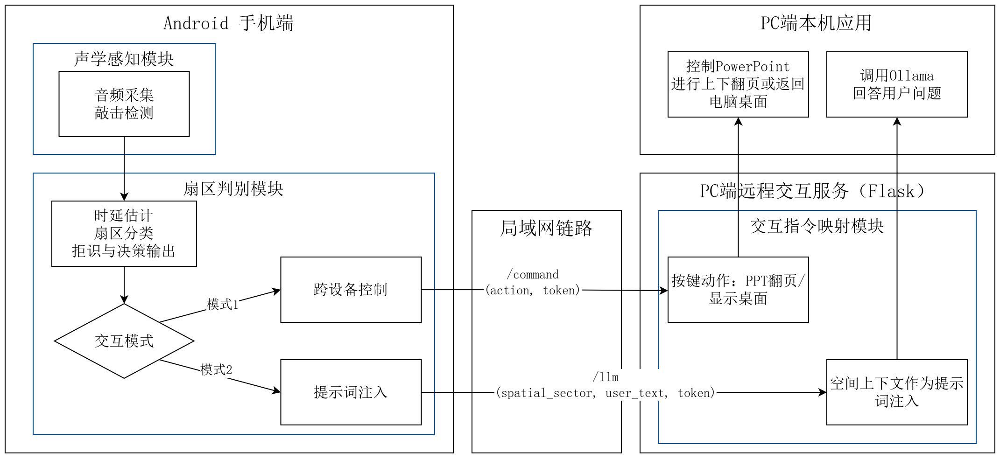
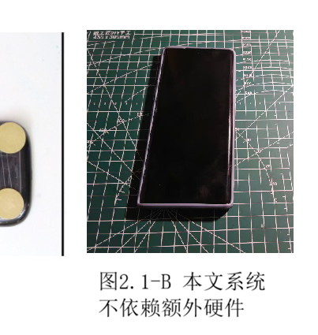
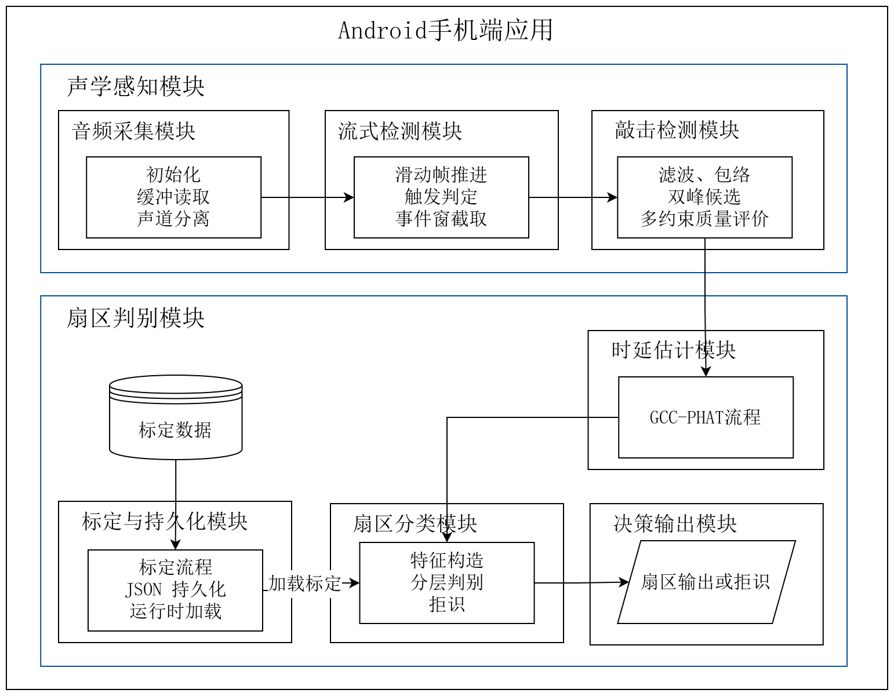
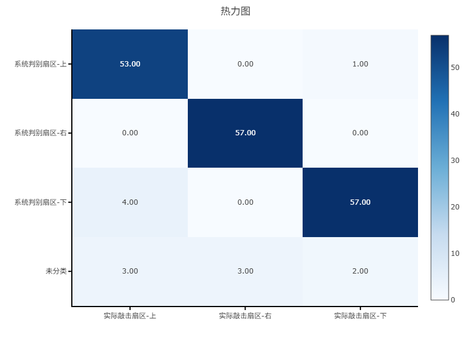
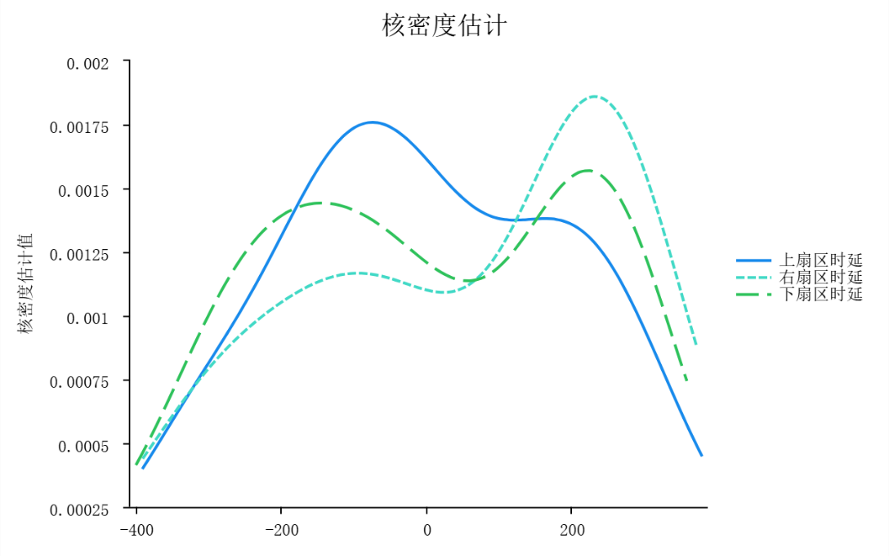
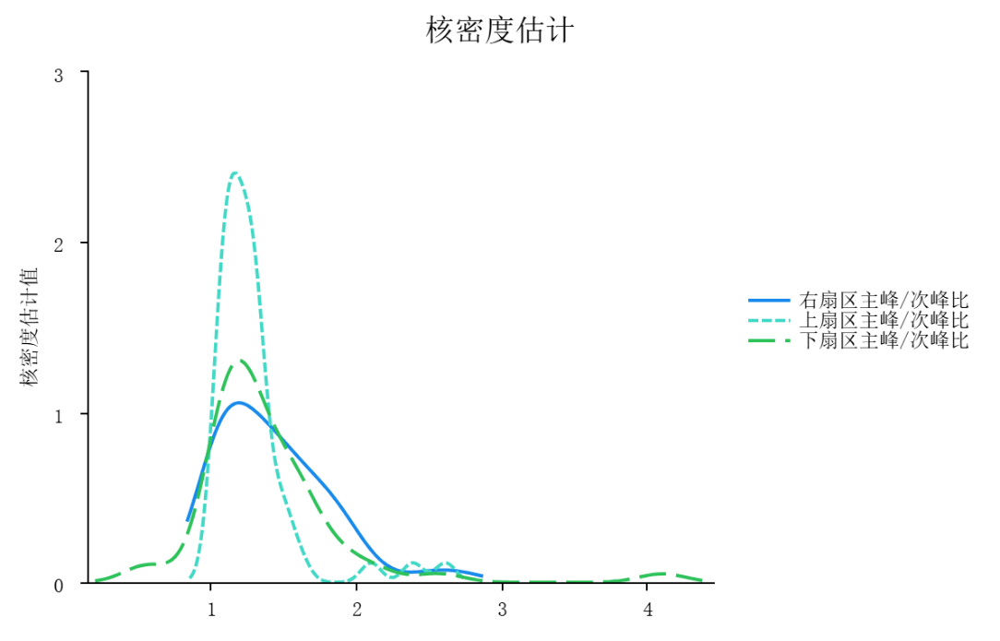

# knockknock

**基于声学感知的桌面交互系统** · 本科毕业设计原型

不增加任何硬件，只用智能手机机身里本来就有的**双麦克风**：在桌面上敲一下，系统听出你敲在手机的上、右、下哪个扇区，再把它变成一条交互指令——翻 PPT、显示桌面，或者作为一句空间上下文喂给本机的大模型。

这是一个面向「低注意力 / 外围交互」的输入通道原型：眼睛不用看屏幕，手不用拿手机，桌面本身就是遥控器。

---

## 1. 系统组成

| 组件 | 位置 | 说明 |
|------|------|------|
| Android 手机端 | [`app/`](app) | 双麦录音、敲击检测、时延估计、扇区判别、标定与可视化调试界面（Kotlin + Compose） |
| PC 端远程服务 | [`pc-remote/`](pc-remote) | Flask 服务，接收手机 HTTP 请求，注入键盘按键或转发给本机 Ollama |

手机与 PC 通过局域网 HTTP 通信，`/command` 走按键模拟，`/llm` 走提示词注入。



实验时的实物形态——手机正向摆在桌面上，不接任何外接传感器：



## 2. 处理链路

手机端各模块的职责与数据流：



```
桌面敲击
   │
   ▼
双通道采集 (16 kHz / PCM16 / STEREO, AudioRecord)
   │  DualChannelAudioRecorder → 100 ms 窗 / 30 ms 帧移滑动分帧
   ▼
敲击事件检测（多约束）
   │  带通 100–4000 Hz → 包络 → 局部峰 → 双峰候选
   │  约束：绝对峰值 / 局部信噪比 / 近场能量比 / 瞬态得分 /
   │        双通道一致性 / 峰宽与尖锐度 / 峰间隔与尾峰比
   ▼
双通道时延估计 (GCC-PHAT)
   │  麦克风几何先验限制搜索范围 → 亚采样抛物线插值
   │  短时片段相关 + 多子带融合 + 峰形一致性加权 → lagConfidence
   ▼
特征向量  (时延 / 通道能量比 / 双峰通道比 / 峰形置信度)
   ▼
扇区判别（用户标定驱动）
   │  均值-对角协方差统计模型 + 对角马氏距离
   │  样本不足时回退 KNN；分层判别（先 Right / 非 Right，再 Top / Bottom）
   ▼
综合置信度与拒识
   │  C = C1 分类匹配度 × C2 敲击质量分 × C3 时延可靠度
   │  独立拒识规则：C 过低 / 类别间隔过小 / 主峰-次峰比不足 / 统计距离过大
   │  输出冷却，抑制重复触发
   ▼
交互指令  →  模式1 POST /command   |   模式2 补充文本后 POST /llm
```

方法细节对应到代码：检测与质量评分在 [`TapDetectionPipeline.kt`](app/src/main/java/com/example/testppppp/audio/detection/TapDetectionPipeline.kt)，时延估计在 [`GccPhatProcessor.kt`](app/src/main/java/com/example/testppppp/audio/dsp/GccPhatProcessor.kt)，分层判别与置信度在 [`TapDirectionClassifier.kt`](app/src/main/java/com/example/testppppp/audio/classification/TapDirectionClassifier.kt)。

## 3. 目录结构

```
.
├── app/src/main/java/com/example/testppppp/
│   ├── audio/
│   │   ├── input/DualChannelAudioRecorder.kt      # 双通道采集与滑动分帧
│   │   ├── detection/StreamingTapDetector.kt      # 流式触发与事件窗缓存
│   │   ├── detection/TapDetectionPipeline.kt      # 检测主流程 + 质量评分 + 调试信息
│   │   ├── dsp/SignalProcessing.kt                # 带通、包络、峰值检测、局部 SNR
│   │   ├── dsp/GccPhatProcessor.kt                # GCC-PHAT、多子带融合、亚采样插值
│   │   ├── dsp/FftUtils.kt                        # FFT / 复数运算
│   │   ├── classification/TapDirectionClassifier.kt # 统计模型 / KNN / 分层判别 / 置信度
│   │   ├── calibration/CalibrationSession.kt      # 标定会话
│   │   ├── calibration/CalibrationRepository.kt   # 标定结果持久化（应用私有目录 JSON）
│   │   ├── TapDetectionConfig.kt                  # 全部可调参数集中定义
│   │   └── TapModels.kt                           # 数据模型
│   ├── remote/                                    # PC 端 HTTP 客户端、指令与模式定义
│   ├── ui/                                        # Compose 界面、ViewModel、实时调试面板
│   └── MainActivity.kt
├── app/src/test/.../TapDetectionAlgorithmsTest.kt # 算法层单元测试
├── docs/images/                                   # README 用图
└── pc-remote/                                     # Flask 远程服务与说明
```

## 4. 快速开始

### 4.1 Android 端

环境：Android Studio（Ladybug 及以上）、JDK 11+、Gradle 8.13（wrapper 已内置）、`compileSdk 36` / `minSdk 24`。

```bash
./gradlew :app:assembleDebug      # macOS / Linux
gradlew.bat assembleDebug         # Windows
```

或用 Android Studio 打开根目录直接 Run。设备需要**具备双麦克风**且支持立体声录音，否则采集状态会提示 `设备不支持`。

### 4.2 PC 端

```powershell
cd pc-remote
python -m venv .venv
.venv\Scripts\activate
pip install -r requirements.txt

set REMOTE_TOKEN=your_shared_secret   # 可选，但建议设置
python app.py                         # 默认监听 0.0.0.0:5000
```

放行 Windows 防火墙对端口 `5000` 的**专用网络**入站；`pynput` 在部分环境需要管理员权限终端。完整接口说明见 [`pc-remote/README.md`](pc-remote/README.md)。

### 4.3 使用流程

1. 手机与 PC 连同一局域网，在 App 底部「跨设备演示」填 PC 的 `Base URL`（如 `http://192.168.1.23:5000`）与 `X-Auth-Token`，点「测试连接」确认 `/health` 通。
2. 授予录音权限 → **开始检测**。
3. 点「开始标定」，按提示依次在手机**上 / 右 / 下**三个扇区各敲击若干次（默认每方向 12 个有效样本）。标定结果写入应用私有目录，换桌面、换设备或改变手机摆位后需重新标定。
4. 标定完成后正常敲击，界面实时显示判定扇区、综合置信度、拒识原因与波形/峰标记；高置信触发后向 PC 发出指令。

### 4.4 交互模式

| 模式 | 手机行为 | PC 行为 |
|------|----------|---------|
| 模式1 · PPT/桌面 | 敲击判定扇区后直接触发 | `POST /command`：Top→上一页，Right→显示桌面，Bottom→下一页 |
| 模式2 · 语言(Ollama) | 判定扇区后弹出输入框，补充文本再发送 | `POST /llm`：扇区映射为英文空间说明，与用户文本拼成 prompt 交给本机 Ollama |

模式2 需要本机已运行 Ollama 并拉取模型（默认 `llama3.2`，可用 `OLLAMA_MODEL` / `OLLAMA_HOST` 覆盖）。

## 5. 关键参数

全部集中在 [`TapDetectionConfig.kt`](app/src/main/java/com/example/testppppp/audio/TapDetectionConfig.kt)，默认值如下（与论文附录 A 对应）：

| 参数 | 默认值 | 含义 |
|------|--------|------|
| `sampleRateHz` | 16000 | 采样率；1 个采样点约 62.5 µs |
| `windowMs` / `hopMs` | 100 / 30 | 滑动分析窗长与帧移 |
| `eventPreTriggerMs` / `eventPostTriggerMs` | 40 / 360 | 事件窗前后保留时长 |
| `bandPassLowHz` / `bandPassHighHz` | 100 / 4000 | 带通范围 |
| `microphoneDistanceMeters` | 0.12 | 双麦间距，决定理论最大时差与搜索范围 |
| `calibrationSamplesPerDirection` | 12 | 每扇区标定样本数 |
| `gccSubBandEdgesHz` | 100 / 1400 / 2700 / 4000 | 多子带融合的频带划分 |
| `testingConfidenceThreshold` | 0.18 | 综合置信度拒识阈值 |
| `statModelDistanceRejectThreshold` | 6.5 | 马氏距离拒识阈值 |
| `testingCooldownMs` | 900 | 输出冷却，抑制重复触发 |

## 6. 实验结果

以下数据来自毕业设计论文第四章，在单一固定桌面环境下测得（荣耀 70，木质桌面，背景噪声 30–60 dB，指尖敲击）：

**敲击事件检测**

| 样本类型 | 样本数 | 检出 / 误触发 | 比率 |
|----------|--------|---------------|------|
| 有效敲击（指尖） | 50 | 48 | 96.00% |
| 有效敲击（橡胶锤） | 50 | 36 | 72.00% |
| 摩擦声 / 其它物体碰撞 / 低质量敲击 | 37 / 23 / 20 | 0 | 0.00% |
| 他人交谈 | 12 | 1 | 8.30% |
| 远场敲击 | 20 | 2 | 10.00% |

**三扇区判别与拒识**

| 扇区 | 测试次数 | 输出准确率 | 拒识率 |
|------|----------|------------|--------|
| 上 | 66 | 80.30% | 9.09% |
| 右 | 63 | 90.48% | 4.76% |
| 下 | 64 | 89.06% | 6.25% |



右侧扇区几乎不与其他扇区混淆，上、下之间存在少量互相误判——这正是分层判别（先分 Right / 非 Right，再分 Top / Bottom）要解决的问题。

| 设置 | 输出次数 | 正确 | 错误 | 有效输出准确率 |
|------|----------|------|------|----------------|
| 原始分类输出 | 200 | 161 | 39 | 80.50% |
| 加入拒识后 | 186 | 173 | 13 | **93.00%** |

拒识机制牺牲了少量响应率，换来有效输出准确率从 80.50% 提升到 93.00%。

**底层声学线索的分布**

| 不同扇区的时延分布（µs，未筛选） | 不同扇区的主峰/次峰比分布 |
|:---:|:---:|
|  |  |

三扇区的时延分布重叠严重、标准差在 180–225 µs 量级，而 16 kHz 下一个采样点就有 62.5 µs——这就是系统不把 GCC-PHAT 时延作为唯一判据、而是与通道能量比和峰形指标一起构成特征向量的原因。

## 7. 开发与测试

```bash
./gradlew :app:testDebugUnitTest
```

[`TapDetectionAlgorithmsTest.kt`](app/src/test/java/com/example/testppppp/TapDetectionAlgorithmsTest.kt) 覆盖峰值检测、GCC-PHAT 时延估计、边界样本拒识、KNN 分层判别、标定会话聚合、流式事件去重等算法路径，不依赖真机。

## 8. 已知局限

- 手机双麦间距短，时延动态范围很小，只适合判别**离散扇区**，做不到桌面上的精确坐标定位。
- 依赖相对固定的使用环境与用户标定；更换桌面材质、设备或手机摆位后通常需要重新标定。
- 拒识会降低误触，但代价是出现「敲了没反应」的情况。
- 结果受采样率与设备性能影响，跨机型未做规模化验证。

## 9. 说明

本仓库为本科毕业设计原型代码，处于可复现演示的水平而非产品化状态：包名 `com.example.testppppp`、部分阈值与界面文案仍保留开发期形态。

完整的算法推导、参数取值依据与实验分析见毕业设计论文《基于声学感知的桌面交互系统设计与实现》（2026），[脱敏版 PDF](https://github.com/ChangAkira/knockknock/releases/tag/paper)。
